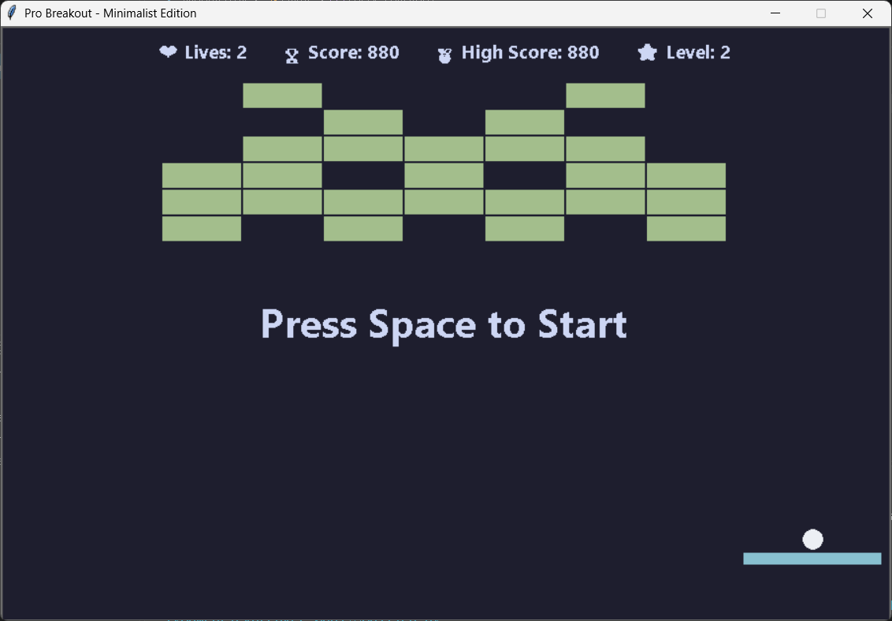

# Brick Breaker - Minimalist Edition

## Fitur Yang Di Tambahkan
Game ini telah dimodifikasi secara signifikan dari *source code* aslinya.
*   **Tema Minimalis & Jendela Lebih Luas:** Area bermain diperluas menjadi 900x600 piksel dengan desain antarmuka datar (*flat design*), tanpa garis tepi, dan menggunakan palet warna pastel di atas latar belakang *Dark Navy* yang elegan.
*   **Pergerakan *Paddle* Super Mulus (Anti-Lag):** Logika pergerakan papan telah dirombak. Tidak lagi bergantung pada *key-repeat rate* bawaan sistem operasi, melainkan menggunakan sistem deteksi `<KeyPress>` dan `<KeyRelease>` di dalam *game loop*, menghasilkan pergerakan responsif yang setara dengan game profesional.
*   **Sistem Level Dinamis (Array 2D):** Game kini memiliki sistem progres level tak terbatas dengan 4 pola susunan balok yang unik: Papan Catur, Monster/Alien, Piramida, dan Bentuk Hati.
*   **Sistem Penyimpanan High Score (File I/O):** Skor tertinggi pemain akan disimpan ke dalam file lokal (`highscore.txt`). Skor ini bersifat permanen dan tidak akan hilang meskipun game ditutup dan dibuka kembali.
*   **Item Power-Up "Super Ball":** Setiap kali balok hancur, terdapat peluang 15% untuk menjatuhkan kapsul neon biru. Jika ditangkap oleh papan, bola akan membesar, berubah warna menjadi merah, dan memberikan *Damage 2x lipat* yang mampu menghancurkan balok keras dalam satu kali tabrakan.
*   **Screen Shake Effect (Getaran Layar):** Menambahkan sensasi visual (*game feel*) di mana seluruh layar akan bergetar secara dinamis selama sepersekian detik setiap kali balok hancur.
*   **HUD Real-time:** Menampilkan informasi Nyawa, Skor, High Score, dan Level saat ini secara langsung di layar dengan sistem pembaruan teks UI yang rapi (tidak ada teks yang menumpuk atau *overlap* saat transisi antar level).
*   **Optimasi Memori (Memory Cleanup):** Menutup celah kebocoran memori (memory leak) dengan memastikan objek balok yang hancur dihapus sepenuhnya dari *dictionary* penyimpanan sistem.

## 🎮 Cara Bermain
1.  Jalankan file Python utama (`Modified.py`).
2.  Tekan tombol **[Space]** untuk melepaskan bola dan memulai permainan.
3.  Gunakan tombol **[Panah Kiri]** dan **[Panah Kanan]** di *keyboard* untuk menggerakkan papan.
4.  Pantulkan bola untuk menghancurkan semua balok dan melaju ke level berikutnya! Tangkap kapsul biru yang jatuh untuk memperkuat bola Anda.

## ⚙️ Persyaratan Sistem
*   Python 3.x
*   Tkinter (Sudah terpasang secara bawaan pada instalasi Python standar)
